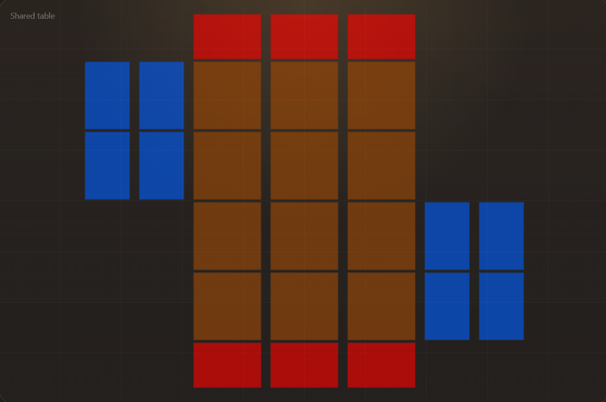

# Playtest improvements

User feedback from testing the current game. Created 15 October 2026.

This file captures requested improvements and bugs for the implementation agent. It is separate from `decision-register-answers.md`, which records confirmed answers to the original design questions. Distinguish observed behaviour, requested behaviour and any unresolved clarification. Do not treat an inferred solution as a confirmed request.

## How to use

Add each distinct improvement under its own stable ID (I-01, I-02, and so on). Record the affected screen/action, what currently happens, what the user wants, and a concrete verification condition when enough detail is available. Ask focused questions only where needed to understand the requested result. Priorities remain unspecified unless the user assigns them.

Use status values: Captured, Needs clarification, In progress, Implemented — unverified, Verified. Capturing an item does not mean it has been implemented or tested. Record verification evidence and implementation notes only when they exist.

If feedback changes a confirmed game mechanic, identify the affected rule and record the explicit new decision rather than silently replacing it. Preserve the user's intended result while leaving routine implementation choices to the build agent.

## Improvement list

## I-01 — Correct field layout

**Status:** Verified by build-agent evidence and an independent UX review (verdict MEETS); awaiting user playtest confirmation.

**Area:** Match board/field layout.

**Observed behaviour:** User reports the current field layout is incorrect. Exact existing placement has not been independently inspected in this feedback session.

**Requested behaviour:**

- Keep six unit zones per player in two rows of three columns. Both players' unit blocks align in the same three central columns, forming four rows total. Their front rows face each other across the centre; their back rows are nearer their own Trap rows.
- For the local/bottom player, place three shared Trap/set-Spell zones directly beneath the two unit rows, one per unit column.
- For the opponent/top player, mirror this: place its three Trap/set-Spell zones above its unit rows, away from the centre.
- Local player's four Power zones are to the right of its two unit rows, in a two-by-two grid. Opponent's four Power zones are to the left of its unit rows in the same grid arrangement. This is mirrored player-relative layout, not both Power blocks on the same screen side.
- Reference colours denote zone roles: brown central squares = units; red outer landscape rectangles = Trap/set-Spell zones; blue portrait rectangles = Power zones. Colour coding is a diagram aid, not a confirmed mandatory final UI palette.
- Power zones have approximately 2:3 width-to-height proportions, matching upright/attack-position cards; Trap/set-Spell zones approximately 3:2 landscape proportions; unit zones approximately square. These are observed reference proportions, not fixed pixel dimensions or a forced card stance. Scale responsively while preserving geometry, clear zone boundaries and selection targets.
- Each two-by-two Power block roughly spans the vertical height of its player's two-row unit block. Align the Trap row to the central unit columns, not the Power block.

**Reference:** User-supplied layout image, copied unchanged from the attachment to [references/field-layout.png](references/field-layout.png). The image supplies board geometry; no additional UI text/buttons, pile locations or exact spacing values should be inferred as requested features merely because they are absent.

**Verification conditions:** Compare the visible match against the supplied reference: six aligned unit zones per player, local Trap row below/opponent Trap row above, local Power block right/opponent block left, correct square/portrait/landscape zone proportions, and no overlaps or clipped prompts. Check local-player perspective on each multiplayer client so each sees their own units at the bottom with their own Powers to the right. That client-relative orientation follows the mirrored requested layout and should be verified rather than hardcoding a single player's identity to screen-bottom.

**Implementation/verification notes:** Seat-relative board in `rldb/src/ui/game_screen.gd` built from one unit size (square unit zones, 2:3 Power, 3:2 Trap); opponent Trap row top / Powers left, local Powers right / Traps bottom. Evidence: `production/qa/evidence/2026-10-15-ui-v3/{1600x1000,1280x800,1920x1080}/02_board.png`, opposite seat in `06_trap_response_prompt.png`, network clients in `ui-v3/net/`. Spec: `design/ux/match-board.md`.

## I-02 — Show valid actions on the hovered card

**Status:** Superseded by F02-01 in `playtest-feedback-02.md` (actions now appear on the click-selected card; hover shows details only). The on-card placement and the inspection-only details panel from I-02 are kept.

**Area:** Card interaction, hover UI and right-hand card-details panel.

**Observed behaviour:** User reports action buttons currently appear in the card-details panel on the right and dislikes that arrangement. Current UI has not been independently inspected for this item.

**Requested behaviour:**

- When the player hovers over a card, show that card's currently valid action buttons on the card itself.
- Move gameplay action controls out of the right-hand details panel; do not require visiting that panel to play, attack or use an available card action.
- Determine availability from current rules state, phase, turn ownership, AP, targets and pending response/choice restrictions. Do not expose illegal actions as enabled buttons.
- Keep the existing button-based interaction model; this is not a request for drag-and-drop.
- The card-details inspection requirement remains: full text, modifiers and status explanations still need an inspection route. This request changes action placement, not permission to remove those details.

**Implementation guidance (inferred, not additional confirmed mechanics):** Keep hover controls stable while the pointer moves from the card surface onto its buttons. Avoid covering essential stats or stealing another card's clicks. Action selection should still open appropriate target/zone/material prompts and obey the suspension of play while opponent responses are pending. Respect hidden-card visibility. Exact overlay placement/style and non-mouse input fallback are not specified.

**Verification conditions:** Hovering an actionable visible card reveals its legal controls directly on that card. Buttons remain clickable during pointer movement; their actions affect the correct card instance. Actions update or disappear as game state changes, do not bypass response locks, and no gameplay action requires the former right-side action buttons. Card details remain accessible. Confirm behaviour on Hand cards and Field cards as their available actions differ.

**Implementation/verification notes:** Legal actions (from the authority's action list; illegal ones hidden, at most one greyed reason) appear in a row just outside the hovered hand/field card with a close delay; suppressed while a choice/response is pending. Details panel is inspection-only. Keyboard: Tab cycles cards and opens their actions, 1–9 pick prompt options. Evidence: `ui-v3/1600x1000/02a_real_mouse_hover_hand.png`, `02a2_real_mouse_moving_onto_buttons.png` (real OS pointer), `02b_hover_hand_card.png`, `02c_hover_field_card.png`, `02d_keyboard_focus_action_row.png`.

## I-03 — Improve visual style, animation and effects

**Status:** Implemented — first production pass verified by screenshots/independent UX review; card art pending from user. Visual direction: somewhere between Hearthstone and The Witcher.

**Area:** Card visuals, match UI and interaction feedback.

**User's visual direction:** Somewhere between Hearthstone and The Witcher.

**Interpretation for the build agent (directional, not separately approved details):** Combine readable, tactile, expressive card interactions and satisfying feedback with a darker, atmospheric fantasy presentation. Consider weathered material, subdued backgrounds and selective magical highlights while keeping important stats/actions easy to read. Avoid turning 'dark' into low-contrast text or 'flashy' into obstructive effects. This is inspiration, not a request to copy franchise artwork, logos, exact frames or branded UI. Palette, fonts, materials and animation intensity remain implementation/art-direction choices for a cohesive first pass.

**Observed behaviour:** User finds current cards ugly and the overall presentation too prototype-like. This is user feedback; no independent visual-quality assessment has been made in this capture session.

**Requested behaviour:**

- Give cards and the surrounding interface a more polished, cohesive, visually engaging style rather than leaving prototype panels and plain cards as the final presentation.
- Add animations and visual effects that make play feel more responsive and expressive.
- Improve the UI alongside the cards; treat this as a coordinated presentation pass rather than isolated decorative changes.
- If additional images are needed, tell the user exactly which assets are needed and what they are for. Individual card art is already expected separately; do not invent a requirement that every asset must be supplied before any polish work can start.
- Preserve I-01's board arrangement and I-02's on-card hover actions. All live stats, statuses, details, response prompts and visibility rules remain functional and legible.

**Implementation suggestions (not individually approved art choices):** Consider consistent card frames and typography, readable stat/cost badges, clear type/race/status treatment, selection/hover states, highlighted legal targets, and restrained transitions for draws, plays, attacks, damage/healing, destruction, status changes and phase progression. Use effects to explain what changed and why rather than merely adding visual noise. Keep animation separate from authoritative rule resolution so it cannot duplicate events or break response timing/reconnection. Provide a way to skip or shorten lengthy effects if implementation finds them obstructive; exact accessibility settings are not yet specified.

**Asset requests:** If an external image is necessary, provide a short asset list naming purpose, desired dimensions/aspect ratio, transparency needs, intended style and mapping to card/zone/UI element. No new images have been generated, purchased or downloaded for this request. Do not claim user-provided art exists when only source filenames are present.

**Verification conditions:** Launch and visually inspect complete gameplay, not just static mockups. Show a noticeable, consistent improvement to card frames, layout, text hierarchy, action buttons and prompts, guided by the Hearthstone/Witcher blend above. Demonstrate animations/effects during a representative turn, attack, response and status change. Maintain readable changing numbers/statuses, responsive input, legal action locks, correct hidden information and stable multiplayer state throughout. Retain before/after screenshots or a short capture for review. No gameplay-mechanic change is requested by this visual direction.

**Implementation/verification notes:** Art bible `design/art/art-bible.md`; OFL fonts Cinzel + Alegreya Sans; procedural frames, cost gems by kind, ATK/DEF shields, status chips with shape cues, card backs, table shader, player plates. Animations (draw, play, attack lunge + arrow, damage/heal numbers, destruction dissolve, status pulse, phase/turn banners, victory/defeat) are driven only by public log events and never affect rules state; reduced-motion and fast-animation settings persist. Before: `production/qa/evidence/2026-10-15-final/`; after: `2026-10-15-ui-v3/`, mid-animation `05b/05c`. Perf (windowed, animations): avg ~5 ms, p95 ~12 ms, p99 ~17 ms. Optional asset requests are listed in the art bible (card back, table texture, frame 9-slices, etc.); card art drops into `rldb/art/cards/<source image name>`.
